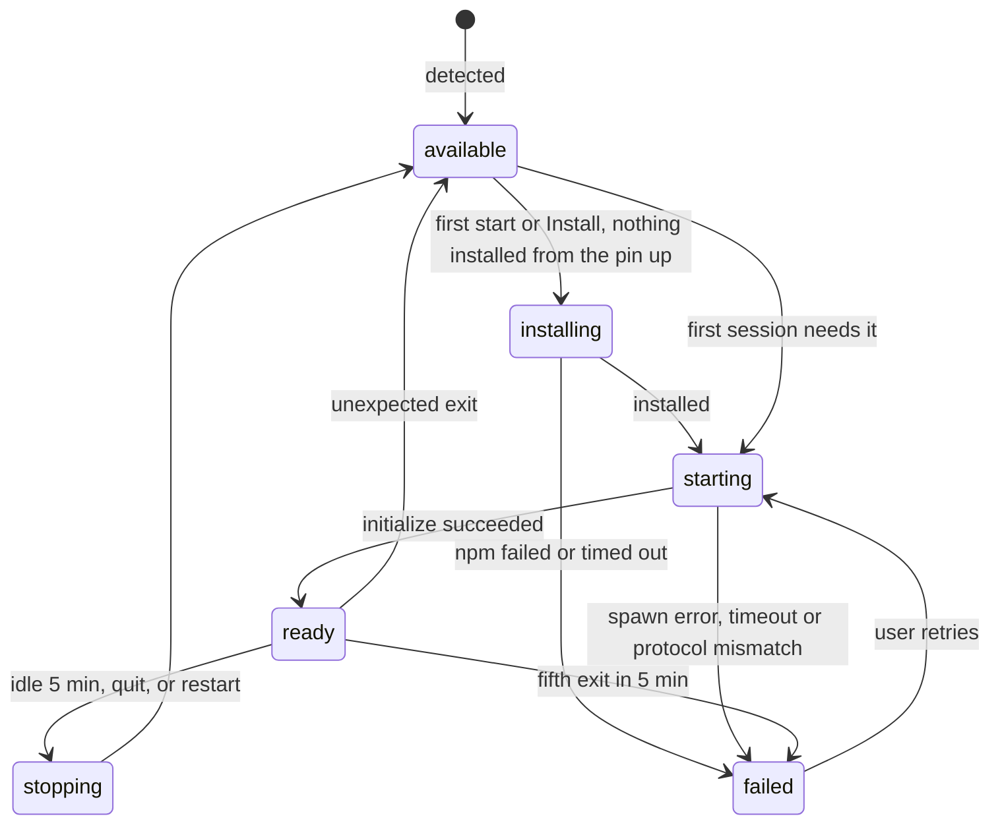

# Agent host

> Status: Draft · Part of the [architecture](../architecture.md) · Built in [M0.1](../milestones/m0.md#work-packages)

The agent host is an Electron `utilityProcess` that owns everything between the UI and the agents: agent processes, ACP connections, live sessions, permission requests, persistence and diagnostics. It renders nothing and shows no native UI; dialogs and OS notifications belong to main.

Electron itself is cross-platform, but this process is where OverBench meets the operating system directly: finding executables, environments, process trees and paths. Every rule below holds on macOS, Windows and Linux; where they differ, [Platform differences](#platform-differences) says how.

## Startup and supervision

`src/main/agent-host.ts` owns the host's lifecycle, through the supervisor in `src/main/utility-host.ts` that also runs the [terminal host](./terminal.md#processes).

1. After `app.whenReady()` and once the settings are read, main forks the host:
   ```ts
   import agentHostPath from '../agent-host/index?modulePath'

   utilityProcess.fork(agentHostPath, [], {
     serviceName: 'OverBench Agent Host',
     stdio: 'pipe',
   })
   ```
   electron-vite builds `src/agent-host/index.ts` as its own bundle because of the `?modulePath` import.
2. Main sends `host:init` (data directory, app version, platform, whether the app is packaged, Electron's executable, the fake agent's path and the agent part of the settings). The host loads its JSON state, sends `host:projects`, starts resolving the shell environment in the background, and replies `host:ready`. Agents wait for the environment; listing projects and sessions does not. Messages from main that arrive while the state loads wait for it; a port's messages queue in the port until then. A host that sends no `host:ready` within 20 s is killed and counts as a crash.
3. Each renderer gets its own port. When a page loads, its preload sends `agent-host:connect`; main checks that the sender is the main frame of one of its windows with `isRendererUrl`, creates a `MessageChannelMain`, passes `port1` to the host in `host:connect` and `port2` to the page with `webContents.postMessage('agent-host:port', null, [port2])`. A reload repeats this, so a page never reuses a stale port. A request that arrives while the host starts or restarts waits and is answered once it is ready.
4. The host's stdout and stderr are forwarded to main's log, line by line, as info and warnings.

### Crash recovery

- When the host exits unexpectedly, main tells every window `agent-host:reset` with `{ failed: false }` at once, restarts the host with backoff (0.5 s, 1 s, 2 s, then doubling up to 30 s; the delay resets after 60 s of healthy running) and sends `host:init` again. Each preload drops its port, rejects what was in flight with `host_restarted`, reports `reconnecting`, and requests a new port, which arrives once the new host is ready; then it reports `connected` and the renderer refetches snapshots for the sessions it shows.
- After five crashes within two minutes, main stops restarting and sends `agent-host:reset` with `{ failed: true }`; the preload reports `failed` and rejects requests until the host runs again. The UI shows the failure with **Restart agent host**, which calls `window.overbench.agents.restart()` (`agent-host:restart`), and **Export diagnostics**. A restart clears the crash count; in any other state it does nothing.
- The host reports the process ID and start time of every agent it starts (`host:agent-processes`). If the host dies without `host:stopped`, main stops those [process trees](#process-trees) itself: one listing, `SIGTERM` to every group in them and `SIGKILL` 2 s later to what is still there, or `taskkill /T /F` on Windows. What it cannot reach, the next host stops from its record. After a clean stop the host has stopped them already, or left what it could not end in its record for the next host.
- Main keeps the last 100 supervision events (start, ready, crash with exit code, scheduled restart, failure, user restart) of both hosts for [diagnostics](#diagnostics).

### Shutdown

On `before-quit`, main delays the quit and runs its quit flow (`src/main/quit.ts`), which also serves the restart to [update](./updates.md#restarting) and, on Windows and Linux, closing the last window:

1. Unless the system is shutting down, and while **Ask before quitting while agents or terminal commands are running** is on, main asks both hosts what is working (`host:busy-request`, and `terminal-host:busy-request` if the terminal host runs), waiting at most 2 s for each; a host that does not answer counts as idle.
2. If something is working, or the Files pane holds unsaved edits, main sends `app:confirm-quit` (`QuitRequest`) to the focused window, or the first one, and waits for `app:respond-quit`. The renderer keeps main told of its unsaved files with `app:set-unsaved`, so main knows without asking; unsaved files ask whatever the setting says, since quitting would lose them. On macOS, closing the window with unsaved files goes through the same question with `reason` `close` and, if confirmed, closes the window only. A page with no `onConfirmQuit` listener, a page that reloads or closes meanwhile, and a quit with no window at all get a native `dialog.showMessageBox` instead, naming the sessions and terminal commands. Cancelling ends the flow; nothing has stopped.
3. Main sends `host:shutdown` and `terminal-host:shutdown` and waits for both hosts to stop every agent and terminal ([Stopping an agent](#stopping-an-agent)) and exit. After 6 s it kills a host that is still running.
4. Main flushes `settings.json`, `window-state.json` and `app-state.json`, then quits, or calls `quitAndInstall` for an update.

### Main and host messages

Typed in `src/shared/host-control.ts`.

| Direction   | Message                | Payload                                                                                                                                                       |
| ----------- | ---------------------- | ------------------------------------------------------------------------------------------------------------------------------------------------------------- |
| main → host | `host:init`            | `userDataPath`, `appVersion`, `platform`, `isPackaged`, `electronPath`, `fakeAgentPath`, `threadWorkerPath`, `settings`                                       |
| main → host | `host:connect`         | `windowId`, and the port in the transfer list                                                                                                                 |
| main → host | `host:settings`        | `settings`, whenever the agent part or the language changes                                                                                                   |
| main → host | `host:busy-request`    | `requestId`, before quitting                                                                                                                                  |
| main → host | `host:grant`           | `requestId`, and the `{ grantId, path, kind }` of each file or folder the user picked or dropped ([attachments](./session-model.md#only-what-the-user-chose)) |
| main → host | `host:shutdown`        | none                                                                                                                                                          |
| host → main | `host:ready`           | none                                                                                                                                                          |
| host → main | `host:agent-processes` | `{ agentId, pid, startedAt }[]` for every running agent, whenever that set changes                                                                            |
| host → main | `host:projects`        | The project paths, whenever the list changes; main relays them to the [terminal host](./terminal.md#shells)                                                   |
| host → main | `host:auth-commands`   | The terminal sign-in commands it built; main relays them to the terminal host, which runs only these ([terminal](./terminal.md#security))                     |
| host → main | `host:attention`       | `sessionId`, `kind` (`permission`, `turn-ended`, `error`), `title`, `body`                                                                                    |
| host → main | `host:badge`           | `count`: pending permission requests across all sessions, whenever it changes                                                                                 |
| host → main | `host:busy`            | `requestId`, and the sessions that are `running` or `awaiting_permission`                                                                                     |
| host → main | `host:granted`         | `requestId`, once the host holds the grants; main answers the renderer only then, and gives up after 5 s                                                      |
| host → main | `host:media-grant`     | `token`, `path`, `mimeType`, `sessionId`: a file main may serve ([media](./media.md#granting-a-file))                                                         |
| host → main | `host:media-revoke`    | `sessionId`, or null for all: the grants to drop when a session is deleted, or a project or every session removed                                             |
| host → main | `host:log`             | `level`, `message`: every entry of the host log, such as a corrupt state file                                                                                 |
| host → main | `host:stopped`         | none; sent just before a clean exit                                                                                                                           |

`fakeAgentPath` is `tools/fake-agent/main.ts` under the app path in development, and `OVERBENCH_FAKE_AGENT` (or null) in a packaged build.

`threadWorkerPath` is the bundle of the [thread worker](./persistence.md#threads), which main builds with `?modulePath` beside the host's, since electron-vite builds the host's own bundle without its worker plugin.

`host:attention` lets main show an OS notification when no OverBench window is focused, including when every window is closed on macOS. Each kind follows its switch in Settings › Notifications, and **Play a sound** decides `silent`. A session has at most one notification at a time: a newer one replaces it. Clicking the notification focuses a window, or opens one, and sends it `app:command` `{ kind: 'open-session', sessionId }`; a page that has not subscribed yet receives the command when it does. The host sends `error` attention only for sessions in the index; a failed create is reported by the rejected request instead.

`host:badge` puts the count where the platform shows one, while Settings › Notifications › **Show a count on the Dock icon** is on:

- **macOS**: `app.setBadgeCount` on the Dock icon.
- **Windows**: an overlay icon on each window's taskbar button (`setOverlayIcon`), a white count on a red disc, the color of the macOS badge. Main draws it at runtime (`src/main/badge-image.ts`, encoded as PNG at 16 and 32 px for 100% and 200% scaling), "1" to "9" and then "9+", so the app ships no image per count and the badge stays sharp at every scale.
- **Linux**: `app.setBadgeCount`, which only launchers that support counts, such as Unity's, show; elsewhere it does nothing.

The badge clears when the host stops or crashes, until the new host reports again.

`settings` is the agent part of the [settings](./persistence.md#settings): binary overrides, the proxy and background fetch, and `locale`, the resolved interface language for the text the host writes ([localization](./localization.md#switching)). Main owns the settings file; the host only receives this part. A new `host:settings` applies at once: changed binary overrides run detection again for those agents, the proxy applies to agents started from then on and to the git service, background fetch goes to the git service, and a new language runs detection again for every agent and resends the environment. A running agent keeps the environment it started with.

On `host:shutdown` the host flushes pending patches, stops every agent with the sequence below, cut short after 3.5 s ([stopping an agent](#stopping-an-agent)), stops the git service, writes pending state, closes the ports, and sends `host:stopped` before it exits. The [process record](#process-trees) gets its last write once what the agents left has been asked to stop, or after 1.25 s, and none after it: a write after `host:stopped` could land as the process ends, and what is still in its grace, or still being listed, is the next host's to stop.

The renderer never sends the host a path to an executable. Changing an agent's binary goes through a main-process IPC call that shows a native file dialog, saves the choice in settings and sends `host:settings`.

## Agent catalog

`src/agent-host/catalog.ts` is the only place that knows how to launch an agent.

```ts
type AgentId = 'claude-code' | 'codex' | 'opencode' | 'fake-agent'

interface AgentDefinition {
  id: AgentId
  name: string
  registryId: string
  launch:
    | { kind: 'package'; package: string; version: string } // installed from npm, run on the user's Node.js
    | { kind: 'binary'; command: string; args: string[] }
    | { kind: 'node-script'; script: string } // the fake agent, on Electron's Node.js
  requiresNode?: string
  install: { hint: string; url: string }
  cli?: AdapterCli // the CLI a package agent's adapter runs, which the user may have installed
}
```

| `id`          | `registryId` | `launch`                                                          | `requiresNode` |
| ------------- | ------------ | ----------------------------------------------------------------- | -------------- |
| `claude-code` | `claude-acp` | package `@agentclientprotocol/claude-agent-acp`, version `0.94.0` | `>=22`         |
| `codex`       | `codex-acp`  | package `@agentclientprotocol/codex-acp`, version `2.2.2`         | `>=22`         |
| `opencode`    | `opencode`   | binary `opencode`, args `['acp']`                                 | none           |

- Package versions are pinned to the ACP Registry entries and bumped deliberately, after a pass with the fake agent and the real agent. OverBench [installs](#installing-adapters) the pinned version on first use. The pin is the oldest version that runs: a newer one the user installed through an [update](#checking-for-updates) runs instead.
- Claude Code and Codex name their CLI (`cli`): the command the user's own copy answers to, `claude` or `codex`, the variable its adapter reads to run that copy, `CLAUDE_CODE_EXECUTABLE` or `CODEX_PATH`, whether the adapter starts it while it initializes (`startsAtInitialize`, Codex only), and whether the adapter pins one CLI version exactly (`pinsVersion`, Claude Code only) ([using the installed CLI](#using-the-installed-cli)).
- `opencode` is looked up on `PATH` unless the user picked a binary in settings. When it is missing, OverBench can [install it](#installing-binary-agents) by one of its vendor's routes; the catalog holds those routes (`installs`).
- In development builds only, the catalog adds `fake-agent`, which runs `tools/fake-agent/main.ts` with Electron's own Node.js (see [testing](./testing.md#fake-agent)). It exists exactly when `host:init` carries a `fakeAgentPath`; the host runs `<electronPath> <fakeAgentPath>` with `ELECTRON_RUN_AS_NODE=1`, so it needs no Node.js on the machine.
- Both pinned packages were checked to exist on npm with `npm view` on 2026-10-20.
- Each agent is shown with its official mark, bundled with the app; the sources and colors are in the [design system](./design-system.md#agent-marks).

## Resolving the environment

Apps started from the Dock, Finder, a desktop launcher or the Start menu do not get the `PATH` a terminal has, so `node`, `npm` and `opencode` are often not found.

- **macOS and Linux**: the host runs the user's login shell once, the way VS Code does:
  ```text
  $SHELL -i -l -c '<electron> -p "<mark> + JSON.stringify(process.env) + <mark>"'
  ```
  with `ELECTRON_RUN_AS_NODE=1`, so Electron's binary acts as Node.js. The JSON between the random markers becomes the agent environment. It falls back to `/bin/zsh` on macOS and `/bin/sh` on Linux when `SHELL` is unset or not absolute. `csh` and `tcsh` accept `-l` only as their sole flag, so they run `-ic` instead, as in VS Code; `pwsh` runs `-Login -Command` with PowerShell quoting and `nu` prefixes the command with `^`. The shell runs detached, without a controlling terminal, so an interactive profile cannot wait for input; on timeout its whole process group is killed.
- **Windows**: GUI apps inherit the user and system environment, so the host uses `process.env` as is. A `PATH` change made after OverBench started needs an app restart, and Settings › Agents says so.
- The resolution times out after 10 s. On timeout or failure the host uses the inherited environment and Settings › Agents shows a warning.
- `ELECTRON_RUN_AS_NODE` and other `ELECTRON_*` variables are removed before the environment reaches an agent.
- A custom proxy from Settings › Advanced replaces `HTTP_PROXY`, `HTTPS_PROXY`, `NO_PROXY` and their lower-case forms; npm and the agents read them. With the default, **Use the environment**, nothing is added.
- The result is cached for the life of the host. **Reload environment** in Settings › Agents resolves it again, for example right after installing Node.js.

## Detecting agents

Detection never starts an agent, so it is cheap enough to run at host startup and whenever Settings › Agents asks.

- **Finding a command**: the host walks the resolved `PATH` itself. On Windows it also tries each `PATHEXT` extension, so `node` resolves to `node.exe`, `npm` to `npm.cmd` and `opencode` to `opencode.exe`.
- **Package agents**: `node` must be found, and `node --version` must satisfy `requiresNode`. Otherwise the status is `node-missing` or `node-outdated`, with the install hint. Detection also reports whether the pinned version is [installed](#installing-adapters). Until it is, `npm` must be found too, or the status is `not-installed` with "npm was not found" as `detail`; an installed adapter runs without npm. Detection also looks for the agent's own CLI and decides which one the adapter runs ([using the installed CLI](#using-the-installed-cli)).
- **Binary agents**: the command or the user's chosen binary must exist and be executable. Otherwise the status is `not-installed`. Detection also lists the agent's [install routes](#installing-binary-agents) as `installMethods`, each `available` when the tool it needs is on `PATH`.

An agent that passes detection is `available`. It becomes `ready` only after a successful `initialize`.

## Installing adapters

OverBench installs the pinned Claude Code and Codex adapters once, into its data directory, with the user's npm, and runs them with the user's Node.js. Newer versions come from the [update check](#checking-for-updates) and the user's one click, through the same install. A launch then costs no registry round trip. `npx -y` revalidated the package with the registry on every launch, which took about 1 s of each agent start (2026-10-21, macOS arm64, median time to the `initialize` answer):

| Launch                                  | Claude Code | Codex    |
| --------------------------------------- | ----------- | -------- |
| `npx -y <package>@<version>`            | 1,563 ms    | 1,411 ms |
| `node <entry>` of the installed package | 211 ms      | 151 ms   |

The approach follows Zed's registry agents (`agent_server_store.rs`), which install into the app's data directory and run `node <bin>`. Zed runs `npm install` with a version range before every launch; OverBench pins exact versions, so it installs only when the pinned version changes.

- **Where**: `<userData>/agents/<agentId>/<version>/`, with the package under `node_modules`, the `package.json` and `package-lock.json` npm works from, and `installed.json` (package, version, Node.js and npm versions, install time), which is written last. An install is named by its `installed.json`, not its directory: a second install of a version that is already there, as an update of the CLI alone makes, goes to `<version>~<installedAt>`. A directory without a complete `installed.json` for the agent's package does not count as installed.
- **Which runs**: a start runs the newest installed version at or above the pinned one, by semver, and of two installs of one version the later one. With none, the pinned version is installed first. An agent with only an install below the pin, kept because the pinned one could not be installed, still counts as installed: its status names that version, and `update` offers the pin ([checking for updates](#checking-for-updates)), so Settings shows **Update**, never **Install**, for it.
- **When**: at the first start of an agent with no install from the pinned version up, whether a session, the New session screen's early start or **Check plan limits** asked for it, or when the user clicks **Install** in Settings › Agents (`agents.install`), which installs without starting the agent. Detection never installs, and neither does `agents.refreshAccount`. Meanwhile the agent is `installing`, with npm's latest output as `progress`, and every start that waits on it shares the one install. `agents.cancelTask` stops it; the agent then goes back to what detection says, not `failed`. When **Install** fails for an agent that still has an older install to run, the request rejects and the agent stays `available`, since a start can run that install.
- **Installing**: in a fresh `.partial-<random>` directory beside the version directories, the host writes a `package.json` that depends on exactly the pinned version, then runs `npm install --omit=dev --ignore-scripts --no-audit --no-fund --no-update-notifier --loglevel=http` there with the agent environment, after `npm --version` for `installed.json`. While the user's own CLI is to run, it adds `--omit=optional`, which leaves out the CLI the adapter brings, and `installed.json` records `withoutCli: true` ([using the installed CLI](#using-the-installed-cli)). npm reads the user's `.npmrc`, so a registry mirror, a token and npm's own proxy settings apply, and it reuses the npm cache that `npx` filled before. When npm exits with 0 and the package's entry exists, the host writes `installed.json` and renames the directory to `<version>`, which is atomic on one volume; otherwise it deletes the directory. Every argument is a constant and the location is the working directory, so the [`.cmd` rule](#spawning) holds for `npm.cmd` too. `.partial-*` directories older than the time limit, left by a quit or a crash, are deleted before the next install, so another instance's install in progress is never touched.
- **Install scripts**: neither pinned adapter nor any of its dependencies has an install script; both bring their native binary (Claude Code's CLI, Codex) as platform-specific optional dependencies (checked 2026-10-21). `--ignore-scripts` keeps it so: a version bump whose install needs a script fails its pass with the real agent instead of running unreviewed code.
- **Dependencies**: the adapter's own dependencies resolve within its ranges at install time, as they did with `npx`, and stay fixed until the next install. The lock file and `installed.json` record what was installed, and Export diagnostics includes both.
- **Time limit**: an install that has not finished after 15 minutes is stopped with its process tree, the way an [agent is stopped](#stopping-an-agent). Quitting stops a running install the same way, with the quit's [time limit](#process-trees) for its `taskkill`.
- **Running**: the host reads `bin` from the installed package's `package.json`, taking its only entry or the one named after the package without its scope, requires the resolved path to stay inside the package folder, and spawns `<node> <entry>` with the absolute `node` path that detection found, never through a shell. Inside the adapter, `process.execPath` is then the user's Node.js, which codex-acp uses to start Codex.
- **Updates**: a release that bumps a pinned version above every install installs the new one at the agent's first start after the update. Between releases, the [update check](#checking-for-updates) finds newer versions and **Update** installs one beside the current install. Once the install a start picks answers `initialize`, the agent's older installs and any directory without a complete install are deleted in the background; a newer install, such as an update that finished meanwhile, stays, and so does the kept one, which the running process uses. If the pinned install fails while an older version is installed, the host starts the newest of those instead, says so in `detail` ("Running 0.93.0: 0.94.0 could not be installed. …") and tries the install again at the next start, so updating while offline does not take an agent away. With no older version, the agent is `failed` with npm's last error lines as `detail`, and **Retry** installs again.
- **Reinstall**: Settings › Agents offers **Reinstall** for an installed adapter (`agents.reinstall`), for an install damaged on disk. It is refused while a session uses the agent or an install or update runs; otherwise it stops the agent, deletes the install a start runs and installs that version again at once. While a process of the agent that a stop [gave up](#stopping-an-agent) still runs, from an earlier stop or its own, it is refused with `busy` and says the agent is still running, before it deletes anything: that process may run from the install, and Windows does not delete a folder in use. It claims the agent before its first step, so a start asked for meanwhile waits and then runs the new install.
- **Measured** on 2026-10-21 (macOS arm64, npm 11.19.1, with npm's cache filled by earlier `npx` runs): installing took 11.4 s for Claude Code and 8.5 s for Codex, mostly npm revalidating package metadata with the registry, and about 3 s once the cache was current. The first start after an install takes longer once, 2 to 6 s for Codex, likely macOS checking the new native binary on its first run; later starts initialize in about 0.2 s.
- **Disk**: each adapter takes about 330 MB (2026-10-21), almost all of it the native binary; without it, 69 MB for Claude Code and 18 MB for Codex (2026-10-22). The copies under `~/.npm/_npx` that earlier builds' `npx` left belong to npm and are left alone.

## Using the installed CLI

Claude Code and Codex do not speak ACP, so their adapters always run, but the CLI inside each adapter is often on the machine already: claude-agent-acp brings Claude Code as `@anthropic-ai/claude-agent-sdk-<platform>` (256 MB) and codex-acp brings Codex as `@openai/codex-<platform>` (318 MB), both optional dependencies. When the user has `claude` or `codex` and it is new enough, the adapter runs it, and OverBench does not download the CLI a second time. The copy the adapter brings is the fallback. `src/agent-host/installed-cli.ts` does the work; detection runs it for each package agent with a `cli`.

- **Finding**: a variable the agent environment already sets (`CLAUDE_CODE_EXECUTABLE`, `CODEX_PATH`) names the program and decides on its own: OverBench passes nothing and the adapter reads it, so Settings shows it with the variable and offers no choice. Otherwise the command is looked up on `PATH` as any [command](#detecting-agents) is.
- **Resolving**: the adapter starts the program without a shell, so it must be a file that runs that way.
  - On macOS and Linux the path stays as found, so a CLI that updates itself by moving a symbolic link keeps working.
  - On Windows an `.exe` is used as found. A `.cmd` or `.bat` of up to 64 KB is read as the shim npm or pnpm writes: the last path it quotes after `%dp0%\` or `%~dp0\`, other than `node.exe`, taken from the shim's folder. A shim whose target is an `.exe`, such as the one for `@anthropic-ai/claude-code`, resolves to it. Any other file, such as a `.ps1`, a script of the user's own or a shim with no such path, is not used and the copy runs.
  - Codex installed from npm is the package's `bin/codex.js`, a Node.js wrapper that only finds the platform's binary and starts it, on every platform. A program whose real path ends in `@openai/codex/bin/codex.js` resolves to that binary, looked up from the package the way the wrapper does ([spawning](#spawning)): the platform's package, else the wrapper's own `vendor` folder. It gets the variables the wrapper sets for an npm install, `CODEX_MANAGED_BY_NPM=1` and `CODEX_MANAGED_PACKAGE_ROOT`; a pnpm, Bun or Vite+ install gets the npm one too, where the wrapper would name its manager, which only changes the update command Codex suggests. Without the binary, macOS and Linux run `codex.js` itself, which its shebang starts and whose `--version` says what is missing; Windows runs the copy. Claude Code's adapter calls its CLI with `execFile`, so on Windows a script target is not used for it.
- **Version**: `<program> --version` with the agent environment, from the home directory, never through a shell, with a 10 s limit; the first `x.y.z` in what it prints is the version (`2.1.304 (Claude Code)`, `codex-cli 0.163.0`). An answer that would repeat, a version or an exit code other than 0, is kept per path, size and modification time until **Reload environment**, so a CLI that updated itself is asked again and an unchanged one costs a `stat`. A timeout, a start that failed or a signal is asked once more at once, since the first run of a freshly updated binary can be slow while the system scans it. Failing the same way again, it is kept like the others, so a program whose `--version` hangs costs one wait per environment, not one per detection; failing another way, it is not kept and the next detection asks again. A program that cannot be started, exits with another code than 0, times out or prints no version counts as one that fails to start.
- **Minimum**: read from the install a start runs, or from the older install it falls back to while the pinned one is not installed, never invented:

  | Agent         | Read from                                                                                                                  | Observed on 2026-10-22                      |
  | ------------- | -------------------------------------------------------------------------------------------------------------------------- | ------------------------------------------- |
  | `claude-code` | `claudeCodeVersion` of `@anthropic-ai/claude-agent-sdk`, which the adapter pins exactly: the CLI the SDK was built against | 2.1.303 for claude-agent-acp 0.94.0         |
  | `codex`       | The lower bound of codex-acp's `@openai/codex` dependency                                                                  | `^0.160.1`, so 0.160.1, for codex-acp 2.2.2 |

  The upper bound of a caret range is not applied: codex-acp talks to `codex app-server`, which newer Codex releases keep (0.163.0 initialized with codex-acp 2.2.2). A range whose lower bound cannot be read (`*`, `||`, a URL) gives no minimum, and the copy runs. Before the adapter is installed the minimum is not known yet.

- **Which runs**: the installed program, when `agents.<id>.cli` is `installed` (the [default](./persistence.md#settings)), it was found and resolved, its version was read, it meets the minimum, and no start with it has failed. Otherwise the copy. Before the first install, a program whose version was read counts as usable. The status says which runs and why (`AgentStatus.cli`, [host protocol](./host-protocol.md#requests)).
- **Launching**: the launch's `env` sets the variable to the resolved path, plus Codex's two variables when they apply, so the launch command shown in Settings and the [terminal sign-in](#sign-in) command run the same CLI.
- **Installing without the copy**: while the installed program is to run, the [install](#installing-adapters) adds `--omit=optional`. The platform packages that hold the CLI are the only optional dependencies of either adapter (checked 2026-10-22), and both adapters run without them when their variable is set; claude-agent-acp's own error names that pair ("Reinstall @anthropic-ai/claude-agent-sdk without --omit=optional, or set CLAUDE_CODE_EXECUTABLE").
- **When the copy is needed later**, because the program went away, is too old, fails to start, or the user chose the copy, and the install a start runs has none (`withoutCli`), the start first installs the same version again beside it with its CLI, as an [update](#checking-for-updates) of the CLI alone does; the install without it is deleted once the new one answers `initialize`. A first install whose program turns out older than the minimum it brings does the same at once.
- **Failing to start**: codex-acp starts `codex app-server` while it initializes, so a broken Codex shows there (`CODEX_PATH=/usr/bin/false` failed `initialize` with "Codex process has exited with code 1"). A Codex start that ran the installed program and whose `initialize` failed or timed out, or whose adapter exited first, is therefore retried once with the copy, and that program is not used again until the user changes the setting or reloads the environment; if the copy fails too, its error is the one shown. claude-agent-acp starts its CLI only for a session, so a failed Claude Code start is the adapter's and says nothing about the program, and the version check is what catches a broken one (`startsAtInitialize` in the catalog). No retry starts while the host is stopping.
- **Updates**: while the installed program runs, an update that would only bring a newer CLI inside the same adapter is not offered, and an adapter update is offered without a CLI version and installed without the copy. The exception is an adapter that pins its CLI (`pinsVersion`), whose update check reads the very version the new adapter needs: when that is newer than the installed program, the update is offered with that CLI version and installs the copy with its progress, since the next start would have to download it anyway ([checking for updates](#checking-for-updates)).
- **Settings**: Settings › Agents shows the program that runs, its path and version, and the choice between the installed program and the copy ([interface](./ui.md#settings--agents)). The choice is saved as `agents.<id>.cli` and reaches the host with the other agent settings; a change clears a failed start, so the installed program is tried again, and runs detection again for that agent. **Retry** on a program that did not start reloads the environment, which does the same for every agent. When the copy is to run but the install has none, the status says so (`needsCopy`) with the copy's rough size (`copyMegabytes`, measured on macOS arm64), so Settings can say that the next start downloads it, and which CLI the running adapter uses (`active`, from the launch it was started with), so Settings says a change waits for the next start only while the two differ.

## Checking for updates

Settings › Agents says when a newer Claude Code or Codex adapter, or a newer CLI inside the same adapter, exists, and **Update** installs it in one click; the home screens do not show it yet ([problem 27](../milestones/m0-feedback.md#27-agent-adapters-have-no-update-check-or-one-click-update)). `src/agent-host/agent-updates.ts` asks npm; the agent manager decides and installs.

- **Asking npm**: for each package agent whose `npm` was found, the host runs, with the agent environment from the home directory, so the user's `.npmrc`, registry mirror, token and proxy apply as for the install:
  1. `npm view <package> version dependencies --json`: the version npm's `latest` tag names, and its dependencies.
  2. `npm view <cliPackage>@<range> <field> --json` for the package and field that [name the CLI](#agent-configuration) (`@anthropic-ai/claude-agent-sdk` and `claudeCodeVersion`, `@openai/codex` and `version`), with the range the adapter depends on. npm prints one value for one matching version and an array for several; the highest is the CLI a fresh install takes.

  Each call has `--no-update-notifier` and `--fetch-retries=0`, so an unreachable registry answers at once instead of at the time limit, and a limit of 20 s. Observed on 2026-10-22: claude-agent-acp 0.94.0 pins `@anthropic-ai/claude-agent-sdk` 0.3.303 exactly, which carries Claude Code 2.1.303; codex-acp 2.2.2 depends on `@openai/codex` `^0.160.1`, so a fresh install of the same adapter version can bring a newer Codex. Both checks took 2.4 s together on macOS, and an unreachable registry failed in 0.3 s.

- **Arguments**: the range comes from the registry and reaches npm's command line, through cmd.exe for an `npm.cmd` on Windows ([spawning](#spawning)). Only a range of version characters (`0-9 A-Z a-z . + - ^ ~ < > = | *` and spaces), which mean nothing to cmd.exe inside double quotes, is passed; any other dependency, such as a git URL, leaves the CLI version unknown. Versions are compared by semver precedence (`src/agent-host/versions.ts`).
- **The decision**: `update` is the latest adapter when it is newer than the install a start runs, or that same adapter version when the CLI a fresh install carries is newer than the installed CLI, read from the install as [Agent configuration](#agent-configuration) does. Otherwise, and before anything is installed, it is null. An agent that runs an install below the pin is offered the pin, or the latest when that is newer. While the user's own CLI runs, only a newer adapter is offered, without a CLI version, since the CLI inside it would not run, unless that adapter needs a newer CLI than the user's ([using the installed CLI](#using-the-installed-cli)). The decision is made against the disk each time, so a release whose pin reaches the latest, or an update installed elsewhere, clears it without a check.
- **When**: each agent is checked once its last check, found or failed, is 24 h old, but no sooner than a minute after the host's first detection, so it stays out of startup. A check that keeps failing, such as a registry mirror without the adapter, therefore waits a day like any other instead of running at every start. **Check for updates** in Settings › Agents (`agents.checkUpdates`) checks every agent at once, after the automatic check if one is running, and a click during the user's own check joins it. A failed check, offline for instance, keeps the previous result and writes a warning to the host log; the automatic one shows nothing else. The user's check rejects only when every agent's check failed, with the reason ("The npm registry could not be reached."), or when no agent has npm.
- **Stored**: each agent's last result, its time and the latest adapter and CLI versions, and when a check last ran even if it failed, in [`state/agent-updates.json`](./persistence.md#what-is-stored-and-where), so a found update shows after a restart without the network. The decision is not stored, since it follows from what is installed.
- **Updating**: `agents.update` installs `update.adapterVersion` with the same [install](#installing-adapters) as a first start, with `alongside` so it gets a directory of its own even for the same version. The current install keeps running and the agent's `state` does not change; the update shows as `task` (`kind: 'update'`), with npm's latest lines as `progress`, throttled like install progress, and the command it runs. The next start runs the new install, and the old one is deleted once that start answers `initialize`; a running agent is not restarted. When the install took another CLI than the check foresaw, what it took becomes the latest, so `update` is null after a success. A failure leaves the old install as it was and `task.state` `failed`, with npm's last error lines in `task.error`; **Retry** calls `agents.update` again and `agents.cancelTask` dismisses it. A failed task whose aim was reached another way goes by itself: a failed update once that update is no longer offered, a failed install once the agent is found installed, so a retry never meets a request that no longer applies. Cancelling stops npm's process tree, deletes the partial directory and resolves the request.
- **What is offered**: any version npm's `latest` tag names, not only versions OverBench has passed. A version that breaks the protocol fails its `initialize` and the agent is `failed`; the older install is still on disk then, since it goes only once the new one initializes, but nothing switches back to it yet.
- **OpenCode** is not checked: it is the user's own program, which its own installer updates, so its `updateCheckedAt` stays null.

## Installing binary agents

OpenCode is the user's own program, which OverBench does not install unless the user asks ([problem 29](../milestones/m0-feedback.md#29-agents-that-are-not-installed-cannot-be-installed-from-here)). When it is missing, Settings › Agents offers **Install** with one of the routes its vendor documents, which `src/agent-host/binary-install.ts` builds from the catalog's `installs`.

- **Routes**, in the order OverBench prefers them, from <https://opencode.ai/docs>, checked on 2026-10-22:

  | `id`     | Shown as                                         | Platforms                      | Available when                  |
  | -------- | ------------------------------------------------ | ------------------------------ | ------------------------------- |
  | `brew`   | `brew install anomalyco/tap/opencode`            | macOS and Linux                | `brew` is on `PATH`             |
  | `script` | `curl -fsSL https://opencode.ai/install \| bash` | macOS and Linux                | `curl` and `bash` are on `PATH` |
  | `npm`    | `npm install -g opencode-ai`                     | All; Windows has only this one | `npm` was found                 |

  The docs recommend the `anomalyco/tap` tap over Homebrew's own `opencode` formula, which is updated less often. These routes install OpenCode 1, whose latest release the ACP Registry lists (1.19.4 on 2026-10-22). OpenCode 2, which these docs mention and which was measured in [process trees](#process-trees), has routes of its own at <https://opencode.ai/v2/docs/> (`brew install anomalyco/tap/opencode-v2`, `curl -fsSL https://opencode.ai/v2/install | bash`, `npm install -g @opencode/cli`) and no Windows package manager; both use the `opencode` command and replace each other. OverBench offers OpenCode 1 only, the release its docs and the ACP Registry name as current; a user on OpenCode 2 keeps it, since Install shows only while no `opencode` is found (decided while the maintainer was away, 2026-10-22; to be reviewed). Switching is one change to `OPENCODE.installs` in `catalog.ts`.

- **Running**: `agents.install` with a `method`, or the first available route without one; a route that is not available, or not offered on the platform, is `invalid_params`. Every word is a constant from the catalog: Homebrew runs `<brew> install anomalyco/tap/opencode`; the script runs `<bash> -c 'set -o pipefail; curl -fsSL https://opencode.ai/install | bash'`, a constant pipeline, where `pipefail` makes a failed download fail the install instead of bash running an empty script; npm runs `<npm> install -g opencode-ai --no-fund --no-audit --no-update-notifier --loglevel=http`, the flags only for progress and quiet. It runs with the agent environment in the home directory, without a terminal, so nothing can wait for input; the script is non-interactive and sends its progress bar nowhere without one, so only its status lines show.
- **Progress, time limit and cancel**: as for an update, `task` (`kind: 'install'`) carries the command as shown, the latest output lines and, on failure, the tool's last lines. The limit is 15 minutes; it and `agents.cancelTask` stop the tool's process tree the way an install of an adapter is stopped.
- **Afterwards**: the script installs into `~/.opencode/bin` and adds it to `PATH` in the shell's startup file, so after an exit with 0 the host [resolves the environment](#resolving-the-environment) again and detects every agent. If `opencode` is still not found, the install fails with the folder it went to, so the user can add it to `PATH` or pick the program: `~/.opencode/bin` for the script, the folder that holds `brew` for Homebrew, and npm's global folder (`npm prefix -g`, with `bin` on macOS and Linux) for npm.
- Installs of the package agents need no route: **Install** runs the [first-use install](#installing-adapters).

## Agent process lifecycle



- **Lazy start**: an agent starts with the first session that needs it, or earlier when the New session screen shows it as the chosen agent (`agents.start`), so the first send waits for the session alone. A start that way also reads the agent's options in a hidden session when none are known, so New session lists its models ([config options](./session-model.md#config-options)). An agent started that way and never used is stopped by the idle stop.
- **Shared process**: one process serves every session of that agent across all projects; ACP multiplexes sessions by `sessionId`. That is true of the adapters, but Claude Code's adapter runs a Claude Code CLI of its own for each session it has open, so idle sessions [let their agent go](./session-model.md#how-the-host-keeps-sessions).
- **Idle stop**: an agent with no live sessions for 5 minutes is stopped to free memory, and starts again on demand. Released sessions are `closed` and do not count.
- **Crashes**: an agent that exits unexpectedly is not restarted. Its sessions go `closed` with their threads, and the next one used starts it again ([session model](./session-model.md#recovering-after-a-crash)). Restarting it at once would bring back a Claude Code CLI for every session it served, used or not. After five unexpected exits in five minutes the agent is `failed`, and no session starts it until the user retries. A start that fails marks the agent `failed` at once, with the reason as `detail`.
- **Live sessions** are those the host holds that are `starting`, `auth_required`, `ready`, `running` or `awaiting_permission`; they decide the idle stop.
- **Timeouts**: `initialize` must answer within 30 s. Installing is a step of its own before the launch, with its own [time limit](#installing-adapters), so a launch never waits for a download.

### Spawning

```ts
spawn(command, args, {
  cwd: os.homedir(),
  env: resolvedEnv,
  stdio: ['pipe', 'pipe', 'pipe'],
  detached: process.platform !== 'win32',
  windowsHide: true,
  shell: needsShell,
})
```

- **Package agents** run `<node> <entry>`, both absolute paths ([installing adapters](#installing-adapters)).
- **Codex**, when the adapter runs its own copy, is started by codex-acp, by default through npm's `codex.js`, a Node.js process that only finds Codex's binary for the platform and forwards signals to it. The host finds that binary in the install the way `codex.js` does and passes it as `CODEX_PATH`, which codex-acp starts directly, with the two variables `codex.js` sets, `CODEX_MANAGED_BY_NPM=1` and `CODEX_MANAGED_PACKAGE_ROOT`, so Codex still knows npm installed it. A `CODEX_PATH` in the user's environment wins, and when the binary is not where npm puts it, codex-acp goes through `codex.js` as before. Measured on 2026-10-22 with codex-acp 2.2.2 and Codex 0.160.1 on macOS: one process of 34 to 46 MB less, and `initialize` in 107 to 127 ms against 140 to 397 ms.
- **Working directory**: the process runs in the home directory. Each session's project folder reaches the agent as `cwd` in `session/new`, `session/load` and `session/resume`.
- **Process groups**: on macOS and Linux, `detached: true` puts the agent in a process group of its own, which the processes it spawns join unless they start their own; Claude Code's CLIs stay in it, but the commands they run do not ([process trees](#process-trees)).
- **Windows `.cmd` shims**: Node.js refuses to spawn `.cmd` and `.bat` files without a shell (CVE-2024-27980), so `needsShell` is true only for a resolved `.cmd` file, such as `npm.cmd` during an install or an `opencode.cmd` shim. That is safe because every argument comes from the catalog; nothing the user or an agent typed ever reaches the command line.
- **stderr** goes into a 64 KB ring buffer per agent. While an agent is `installing` or `starting`, the latest lines of npm's output or of the agent's stderr are shown as progress.

### Connecting

```ts
const app = client({ name: 'OverBench' })
  .onRequest(methods.client.session.requestPermission, (ctx) => sessions.requestPermission(ctx))
  .onNotification(methods.client.session.update, (ctx) => sessions.applyUpdate(ctx.params))

const connection = app.connect(
  ndJsonStream(Writable.toWeb(child.stdin), Readable.toWeb(child.stdout)),
)

const init = await connection.agent.request(methods.agent.initialize, {
  protocolVersion: PROTOCOL_VERSION,
  clientInfo: { name: 'OverBench', version: appVersion },
  clientCapabilities: {
    fs: { readTextFile: false, writeTextFile: false },
    terminal: false,
    auth: { terminal: true },
    session: { notices: {}, compaction: {}, configOptions: { boolean: {} } },
  },
})
```

- `PROTOCOL_VERSION`, `client`, `methods` and `ndJsonStream` come from the SDK's `@agentclientprotocol/sdk/unstable` entrypoint, not the stable one. The SDK's client validates every `session/update` against its entrypoint's schema before any handler runs, and the stable schema has no `subagent_update` or `session_message`, so sub-sessions would never arrive. Nothing else unstable is advertised or called: the client capabilities add only `subagents: {}`, and the prompt response's `usage` is read when present. The SDK is bundled into the host build.
- An update variant the schema does not know would fail that validation and be logged by the SDK, so the host's stream tap drops variants outside the mapper's list before the SDK sees them and records each in the agent's diagnostics.
- Updates for a session id nobody registered yet, such as the commands an agent sends right after answering `session/new`, wait in a bounded buffer (32 sessions, 2,000 updates, 60 s) and are delivered when the session registers. Updates for a session OverBench closed are dropped and recorded instead.
- If `init.protocolVersion` is not 1, the agent is marked `failed` with "unsupported protocol version".
- The host keeps `init.agentCapabilities`, `init.authMethods` and `init.agentInfo` per agent. Every optional call is gated on these capabilities.
- Why each client capability is on or off is explained in the [architecture](../architecture.md#client-capabilities).

### Stopping an agent

The same sequence runs on idle stop, restart and quit, for every agent in parallel:

1. List its [process tree](#process-trees) while it still runs.
2. Close the agent's stdin. ACP agents exit when their input ends.
3. After 2 s, if it is still running: on macOS and Linux, send `SIGTERM` to every group in its tree; on Windows, run `taskkill /PID <pid> /T /F`.
4. After 3 more seconds on macOS and Linux, send `SIGKILL` to what is left of the tree.
5. Once it has exited, stop what is left of its tree: `SIGTERM`, and `SIGKILL` 3 s later in the background, or `taskkill /T /F` on Windows.

The same last step runs after an agent [crashes](#agent-process-lifecycle).

At a quit the agents get 3.5 s in all (`quitStopMs`), so the host still writes its state and sends `host:stopped` before main's kill. A start in progress is not waited for: the process it launched is stopped at once, which ends its `initialize` (up to 30 s otherwise), and an install is stopped with its tree; once the quit has begun nothing starts, installs, updates or checks for updates. An agent still running after the 3.5 s, such as one that ignores EOF and `SIGTERM`, is ended at once wherever its sequence has got to: `SIGKILL` to the groups its `SIGTERM` listed, or else to its own, on macOS and Linux, and `taskkill /T /F` with the quit's limit on Windows. The host waits up to 0.5 s for it to exit, so the last step starts before the record's last write; what that misses, the [process record](#process-trees) keeps for the next host.

A stop can end with the agent still running: when `taskkill` fails or times out on Windows, or when the process has not exited after `taskkill`, or after `SIGKILL` on macOS and Linux. The stop then names that step (`taskkill failed: …`, `did not exit after taskkill`, `did not exit after SIGKILL`) in the host log and the agent's diagnostics, the stop of a start that failed included. Its stdin is closed, so the host gives that process up: its runtime is never handed to a session again, the agent is `available`, or `failed` after a failed start, and the next session that needs it, after a retry when it is `failed`, starts a new process. The given-up process stays in `host:agent-processes` until it exits, so main stops it if the host dies, and the host stops its tree once more at once, as the last step does, and again at quit. Until it exits, the agent cannot be [reinstalled](#installing-adapters).

### Process trees

An agent's own process group is not enough, measured on 2026-10-22 with claude-agent-acp 0.94.0, codex-acp 2.2.2 and opencode 2.0.32 on macOS. Claude Code runs each command, a `run_in_background` one included, in a process group of its own under its CLI; Codex runs each MCP server, and its code-mode host, in a group of its own; `opencode acp` runs `opencode serve` in one. All of these exit within 0.5 s of their agent ending, even by `SIGKILL` to its group, because they read from it, and Claude Code's CLI stops the commands it ran when its input ends or it gets `SIGTERM`. A background command outlived only a `SIGKILL` to the group, which a hung agent, a host that died and an app killed outright all end in; it then ran on with no parent.

- **Finding a tree**: one listing of the system's processes, `ps -A -o pid=,ppid=,pgid=,etime=` (10 to 20 ms on macOS), or `Get-CimInstance Win32_Process` through PowerShell on Windows (usually under 1 s on `windows-latest`, measured on 2026-10-23). On macOS and Linux the tree is the agent's group, whose members keep it after the agent exits, and everything descended from the group; signals go to each group the tree leads, so they reach processes started since the listing. Windows has no groups but reparents nothing: the tree is everything descended from the agent, whose children keep its pid as their parent after it exits.
- **Listing while it runs**: on macOS and Linux a process the agent started directly in a group of its own is reparented when the agent exits, so only a listing taken before finds it. On Windows, Node.js puts each child it starts without `detached` in a job object that ends with its parent, so a CLI ends with its agent and what the CLI started detached keeps a parent pid that leads nowhere (libuv's job object; found on 2026-10-22, when CI on `windows-latest` left the fake agent's detached grandchild running after a crash). The host lists an agent's tree before it stops it, and 10 s after the agent talks over ACP, at most once every 10 s, so an idle agent costs nothing.
- **Identity**: a process is named by its pid and start time, so a reused pid is never taken for it. After a root has exited, only what started while it was last seen running is followed, since a process that took its pid later may lead a group or have children of its own.
- **The record**: `state/agent-processes.json` holds each running agent, its tree as last listed, and what is being stopped until its grace ends, each with its start time and when it was last seen running, written at once on every change. A host stops what the last one left there as soon as it starts, so a crash of the host or of the whole app, or a quit that ended before a grace did, leaves nothing running for long.
- **Windows**: each listing starts PowerShell, so the host stops what an agent left once it has exited in the background; `host:shutdown` waits for that, up to 1.25 s, before it writes the record for the last time, so a quit ends what the agents left instead of leaving it to the next launch.
- **Time limits**: a listing or a `taskkill` may take 10 s, as a slow machine may need, and while the host quits a listing 1.5 s (1 s with `ps`) and a `taskkill` 0.5 s; then the tool is killed and the call fails like any other, which leaves the trees in the record for the next host and names the tool in the warning. Any other stop has time, and what its listing misses is lost for good: a process only that listing could tie to the agent. The quit's limits fit main's 6 s after `host:shutdown`. On Windows the longest wait is the listing before the stop, 1.5 s, the 2 s EOF wait, `taskkill`, 0.5 s, and the 1.25 s the last write of the record waits, 5.25 s; on macOS and Linux it is the listings before the stop and after the exit, 1 s each, the EOF wait and the same 1.25 s, 5.25 s too. On Windows the listing before the stop gets the larger share, since what the last write's wait misses stays in the record for the next launch. At a quit, a stop whose `taskkill` timed out does not wait for the agent to exit; the [last step](#stopping-an-agent) tries again. On Windows the listing after the exit keeps the long limit, since only the last write waits for it. A hung agent's own waits, the 1 s for removing the session that read its options and, on macOS and Linux, 3 s after `SIGTERM` and 3 s after `SIGKILL`, are cut short by the quit's 3.5 s for the agents and its 0.5 s for ending what is left, which keeps to the same 4 s before the last write and leaves main's last 2 s to the writes, the record's at most 1.25 s among them. In CI on 2026-10-23, under the test suite's load, a listing took 250 to 450 ms on Windows and 10 to 50 ms with `ps`, and `taskkill` about 50 ms. Main's stop of the trees of a host that died, which nothing waits for, has the long limits.
- **Not followed**: a process that left the tree before a listing saw it: one started less than 10 s before the agent crashes or the app is killed, either by the agent directly in a group of its own on macOS and Linux, or on Windows detached by a child that ends with the agent; and a daemon whose parent had already exited.

## Sign-in

ACP reports a missing sign-in as JSON-RPC error `-32000` (`auth_required`). The host then sets the agent's sign-in state, and every session waiting on it shows the agent's `authMethods`.

- **`agent` methods** (Codex): the host calls `authenticate` with the method `id`. The agent runs its own flow, such as opening the browser. On success the host retries what failed.
- **`terminal` methods** (Claude Code, OpenCode): the agent must run interactively. The command is the agent's launch command plus the method's `args`, with its `env` and the launch's variables as a prefix (`NAME=value …` on macOS and Linux, `set "NAME=value" && …` on Windows), for example `<node> <userData>/agents/claude-code/0.94.0/node_modules/@agentclientprotocol/claude-agent-acp/dist/index.js --cli auth login --claudeai` or `opencode acp --login`. **Sign in in terminal** runs that command in the built-in [terminal](./terminal.md#working-with-the-session) and retries when it finishes. The command is also shown quoted for the user's platform, with a copy button and **I've signed in, retry**, for those who prefer their own terminal.
- **Logout** is offered only when the agent advertises `agentCapabilities.auth.logout`. It calls `logout`; the agent's sessions then need sign-in again.
- Claude Code and Codex also push `_auth/status_update`, an adapter extension that names the account and plan ("Claude Max", "ChatGPT Plus"). It sets the sign-in state without waiting for a failed request, and the plan label heads the [plan limits](./session-model.md#plan-limits). The catalog marks these agents (`reportsAccount`), which `agents.refreshAccount` starts for Settings › Agents. It also marks an agent that writes progress notes as messages (`progressNotes`, Codex), which the status passes on as `capabilities.progressNotes` for the thread to fold them ([Interface: tool calls](./ui.md#tool-calls)). The last account and plan limits each agent reported are kept in `state/agents.json` and shown after a restart until it reports again; a signed-out account is not kept, and **Sign out** forgets both. The capabilities of its last `initialize` are kept there too, with the `agentInfo` version that gave them, and the status reports them until the agent initializes again while the adapter a start would run is that version, so a reopened session shows Fork before its agent starts; a binary agent, whose version is known only once it runs, waits for its start. The host still checks the running agent's own answer before it acts.
- OverBench never reads, stores or forwards credentials.

## Out of credit

ACP has no error for a model provider that refuses a request because the account has no credit left. The adapters pass the provider's reply on as an internal error (`-32603`) whose message carries the provider's words, as in "Internal error: Insufficient Balance (request_id: …)". The host takes a failed `session/prompt` as out of credit when its message or its `data`, read as text, holds one of these phrasings, compared without case, or when its `data` gives HTTP status 402 as a `status` or `statusCode` field:

| Provider  | Phrasing                                            |
| --------- | --------------------------------------------------- |
| DeepSeek  | `Insufficient Balance`                              |
| Anthropic | `credit balance is too low`                         |
| OpenAI    | `insufficient_quota`, `exceeded your current quota` |

- The phrasings are one table in the host, with a test for each row. A provider joins it with the words of a real error from it.
- A rate limit (429) or a plan's usage limit is not out of credit: both pass with time, and plan limits have [their own display](./session-model.md#plan-limits).
- The agent itself is fine: it stays started and the session `ready`, with the prompt kept for **Retry** ([prompt turns](./session-model.md#prompt-turns)). Any other agent error stays "The turn failed".

## Agent configuration

Settings › Agents shows, in its list and on each agent's page, which CLI version its adapter runs and where the agent reads its own configuration, with a button to reveal each place in the system file manager. `agents.details` ([host protocol](./host-protocol.md#requests)) answers when they show; `src/agent-host/agent-details.ts` does the work. OverBench never reads or changes these files. It only checks whether they exist, and main reveals one with `shell:show-item`, which selects it in the file manager and never opens it.

| Agent         | Folder                                                | Settings                                                                                          | Instructions      |
| ------------- | ----------------------------------------------------- | ------------------------------------------------------------------------------------------------- | ----------------- |
| `claude-code` | `$CLAUDE_CONFIG_DIR`, else `~/.claude`                | `settings.json` in the folder                                                                     | `CLAUDE.md` in it |
| `codex`       | `$CODEX_HOME`, else `~/.codex`                        | `config.toml` in the folder                                                                       | `AGENTS.md` in it |
| `opencode`    | `opencode` in `$XDG_CONFIG_HOME`, else in `~/.config` | `$OPENCODE_CONFIG`, else `opencode.json` or `opencode.jsonc` in the folder, the first that exists | `AGENTS.md` in it |
| `fake-agent`  | none                                                  | none                                                                                              | none              |

- **Variables** come from the [resolved agent environment](#resolving-the-environment), not from the host's own, so they match what the agent sees. A blank value counts as unset, and a relative one is taken from the home directory, where agents are spawned. Each item's `env` names the variable that set that exact path, so a moved folder says so while the files inside it, which only follow the folder, carry none; `OPENCODE_CONFIG` names the settings file itself.
- **Existence** is one `stat` per place, following symbolic links: the folder must be a directory and the others files. A missing path, or one below a file, is `exists: false`. Any other error also gives `exists: false` and a warning in the host log. For OpenCode, when neither settings file exists the item shows `opencode.json`.
- **CLI version**: while the user's own CLI runs, Settings shows the version it reported ([using the installed CLI](#using-the-installed-cli)). The version of the adapter's copy, which `agents.details` answers, is read from the installed adapter's dependencies, never by running the CLI: the install's `node_modules/` plus the file below, for the install in use: the one a start picks, or the fallback until the pinned one installs, as for diagnostics. After an update, that is the new install, which the next start runs. The answer is `null` while no adapter is installed, which is normal before the agent's first start, and for an agent with no bundled CLI; a file that does not parse or lacks the field is also `null`, with a warning in the host log. OpenCode is its own CLI, so its version is the `version` of its status.

  | Agent         | File                                          | Field               | What it names                                                   |
  | ------------- | --------------------------------------------- | ------------------- | --------------------------------------------------------------- |
  | `claude-code` | `@anthropic-ai/claude-agent-sdk/package.json` | `claudeCodeVersion` | The Claude Code CLI that the adapter's SDK bundles              |
  | `codex`       | `@openai/codex/package.json`                  | `version`           | The CLI that codex-acp starts from `@openai/codex/bin/codex.js` |

  Checked on 2026-10-21 with claude-agent-acp 0.94.0 (SDK 0.3.303, Claude Code 2.1.303) and codex-acp 2.2.2 (Codex 0.160.1).

## Diagnostics

- For each agent, the host keeps the last 2,000 ACP messages (direction, time, method, size and the full JSON) in a ring buffer, plus the stderr ring buffer and process events (start, ready, exit code).
- **Export diagnostics** asks the host for a bundle: app and agent versions, agent states, capabilities, the buffers, and the platform. The environment is reduced to `PATH`, `SHELL` and the detected Node.js version; other variables can hold secrets and are left out. The renderer passes the bundle to main (`diagnostics:save`), which adds its own section under `main` and writes pretty JSON to a path chosen in a save dialog, `overbench-diagnostics-<date>-<time>.json` in Downloads by default. Main's section holds the app, Electron, Chromium, Node.js and V8 versions, the platform, architecture and OS version, the launch time to the first interactive frame, the state and supervision events of both hosts, and main's last 500 log records.
- Before exporting, the UI warns that the bundle contains prompts and code from recent sessions.
- In development, `OVERBENCH_ACP_LOG=1` also mirrors ACP traffic to the host's stdout; packaged builds ignore it.
- The buffers are bounded by size as well as count: the traffic of one agent holds at most 8 MB of JSON, a message over 256 KB is kept as a truncated preview, each agent keeps its last 500 process events, and the host log its last 2,000 entries. Messages are stored as JSON text, which costs far less memory than the parsed objects.

## Project files

- The Files pane lists, reads, searches and saves a project's files through `files.list`, `files.read`, `files.search` and `files.write` ([host protocol](./host-protocol.md#requests)). `src/agent-host/files.ts` does it for a registered project, at its canonical path; the renderer has no file system access of its own.
- **Listing**: `git ls-files --cached --others --exclude-standard`, minus the tracked files deleted on disk, so ignored files stay out. Without git, or outside a repository, a breadth-first walk reads at most 20 levels, skips `.git` and `node_modules`, and does not follow links to folders. Paths are relative with `/` on every platform and sorted by code unit; the list stops at 50,000 files and says so with `truncated`.
- **Reading**: a file up to 1 MiB comes back as UTF-8 text, with its `version`, the SHA-256 of its bytes, and `editable`, false when the bytes are not valid UTF-8 and writing the decoded text back would change them. A byte order mark stays in the text. A NUL byte in its first 8,000 bytes makes it `binary`, and a larger file is `too-large` with the limit it passed; neither is sent. A file named as a picture, a sound or a video ([media](./media.md#what-counts-as-media)) is not read: when its first bytes say it is one, it comes back as `media` with its kind, its MIME type taken from those bytes rather than its name, its size, its pixel size when the header holds it, and a URL of the [media scheme](./media.md#the-media-scheme), from which the renderer shows or plays it with no size limit. One whose bytes are no such format is read as any other file.
- **Searching**: `git grep -F -i` with `--untracked --exclude-standard` finds literal text, ignoring case, in the files git would list. Outside a repository the host reads the walk's first 5,000 files, skipping binary ones and those over 1 MiB. Results stop at 500 matches, each line cut to 300 characters, and `truncated` says more exist.
- **Writing**: `files.write` replaces the text of a file that exists; it never creates, renames or deletes one, and refuses a path inside `.git`. The text is written as UTF-8 and may be at most 1 MiB. With a `version`, the host first reads the file and answers `conflict` when its SHA-256 differs, so a save never overwrites an edit made since the read, by an agent or anyone else; a null `version` writes regardless, after the user chose to keep their edits. The write goes to a temporary file beside the target (`.<name>.<random>.overbench-tmp`), takes the target's mode, is flushed to disk, and is renamed over the target, so a crash leaves the old file or the new one, never half of each. A file with other hard links is written in place instead, since a rename would split it from them, and so is one Windows will not replace while another program holds it open. The answer is the new `version` and size.
- **Mentions**: an `@` [attachment](./session-model.md#only-what-the-user-chose) names a project's file or folder through `attachments.add`; the host checks the path as a read does and finds what it is, a file or a folder, before the attachment's record takes it.
- **Containment**: a path with `..`, a NUL, or an absolute form is refused, and a read, a write or a mention resolves the path with `realpath` and requires the result inside the project folder by the platform's [path rules](#platform-differences), so a symbolic link cannot lead out of the project.
- Git runs through the same runner as the [git service](./git.md): never a shell, a 10 s timeout, the agent environment, and it stops with the host.

## Platform differences

| Concern                         | macOS                                                                   | Linux                        | Windows                                                                  |
| ------------------------------- | ----------------------------------------------------------------------- | ---------------------------- | ------------------------------------------------------------------------ |
| Environment at launch           | Minimal `PATH`; resolve the login shell                                 | Same as macOS                | Inherited user and system environment                                    |
| Finding commands                | `PATH`                                                                  | `PATH`                       | `PATH` with `PATHEXT` (`node.exe`, `npm.cmd`, `opencode.exe`)            |
| Spawning                        | Direct                                                                  | Direct                       | `.cmd` shims through a shell, with catalog-only arguments                |
| Installed Claude Code and Codex | As found on `PATH`; npm's `codex.js` becomes its binary                 | Same as macOS                | An `.exe`, or the target an npm or pnpm `.cmd` shim names; else the copy |
| Process tree                    | Own process group (`detached`); trees listed with `ps`                  | Same as macOS                | No groups; parent links listed through CIM, `taskkill /T`                |
| Stopping                        | EOF, `SIGTERM`, `SIGKILL` to every group in the tree                    | Same as macOS                | EOF, then `taskkill /T /F`                                               |
| Path comparison                 | Canonicalize with `fs.realpath.native`; volumes may be case-insensitive | Canonicalize; case-sensitive | Canonicalize; case-insensitive, drive letters and UNC paths              |
| Line endings from tools         | LF                                                                      | LF                           | Often CRLF; normalized before rendering                                  |
| Data directory                  | `~/Library/Application Support/OverBench`                               | `~/.config/OverBench`        | `%APPDATA%\OverBench`                                                    |
| Shell quoting for display       | POSIX single quotes                                                     | POSIX single quotes          | `cmd.exe` double quotes                                                  |
| Installing OpenCode             | Homebrew, the install script, then npm                                  | Same as macOS                | npm only                                                                 |

Paths are always compared after canonicalizing with `path.resolve` and `fs.realpath.native`, never as raw strings. On Windows only drive paths (`C:\…`) and UNC paths count as absolute; a path such as `\src` depends on the host's current drive and is refused.

## Alternatives considered

- **One agent process per session**: stronger isolation, but every session pays the startup cost and the memory. ACP already multiplexes sessions, so M0 shares one process per agent.
- **Running the adapters on Electron's Node.js** (`ELECTRON_RUN_AS_NODE`): rejected on 2026-10-21. It would remove the Node.js requirement, but the variable reaches every command the agent runs, so an Electron app the agent starts, such as `pnpm dev` in an Electron project, runs as plain Node.js instead (a child `electron --version` printed `v24.22.0`). Removing it for the adapter's children breaks codex-acp, which starts Codex through `process.execPath`. A wrapper around `process.execPath` that restores it is fragile, and on Windows a `.cmd` wrapper cannot be spawned without a shell. The user's Node.js starts the adapters as fast (211 ms against 213 ms for Claude Code's `initialize`).
- **Keeping `npx`**: `npx --prefer-offline` skips the registry check but still took 557 ms (Claude Code) and 476 ms (Codex) to `initialize`, and its cache is npm's to evict, which turns a launch into a silent download.
- **Bundling adapters in the installer**: rejected; `claude-agent-acp` is proprietary and adapters update faster than OverBench releases.
- **Walking a tree with `pgrep -P`**, as VS Code's `terminateProcess.sh` and the `tree-kill` package do: one process per level of the tree, and blind to a process whose parent has exited. One listing walked in memory costs one `ps` and also finds the agent's group.
- **Marking agents with an environment variable** and stopping every process that carries it, as Jenkins' ProcessTreeKiller does: it would also stop what an agent detached on purpose, Windows offers no way to read another process's environment without native code, and Codex starts its MCP servers with a filtered environment.
- **Listing trees on a timer**: catches what a crash leaves even without traffic, but costs a `ps` for every interval while agents sit idle. Listing after traffic covers the processes agents start, which they start while they talk.
- **`@vscode/windows-process-tree`** for the Windows listing: faster than PowerShell, but a native dependency for a listing the host takes at most once every 10 s while an agent talks, and around its stop.
